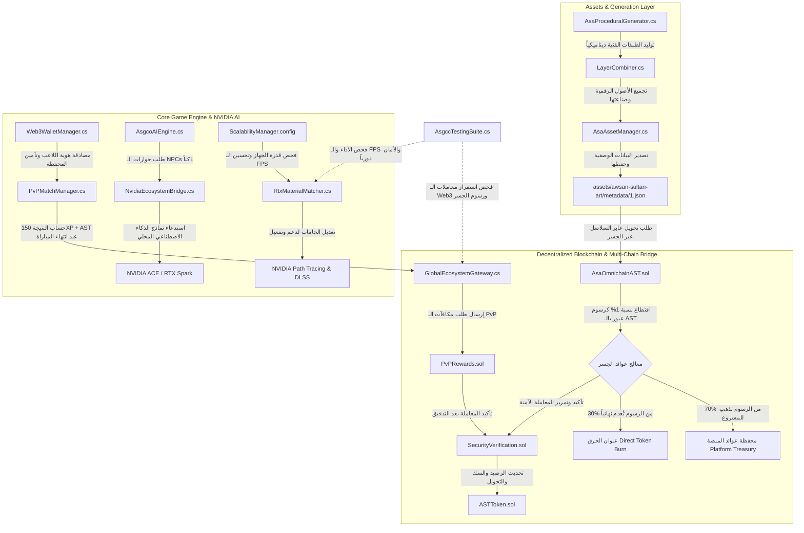

# 📊 المخطط الهندسي لتدفق البيانات وتكامل الأنظمة (ASGCC Data Flow)

يوضح هذا المخطط التفاعلي دورة حياة الأصول الرقمية، عمليات معالجة الرسوميات والذكاء الاصطناعي المحلي، بالإضافة إلى بروتوكول اقتطاع الرسوم وحرق العملة عند العبور عابر السلاسل:



---

### 📂 الجزء الثالث: الورقة البيضاء التقنية المحدثة `TECHNICAL_WHITEPAPER.md`
**أين تضعه:** اذهب إلى داخل مجلد `docs/` وقم بإنشاء ملف جديد باسم `TECHNICAL_WHITEPAPER.md` وانسخ فيه الكود التالي بالكامل:

```markdown
# Technical Whitepaper: The Awsan Sultan Game Core Crypto Architecture (ASGCC)
**Author:** Eng. Awsan Adel Abdulbari Ahmed Sultan
**Version:** 1.1.0  
**Target:** Next-Gen Hybrid Web3 & Local-AI Gaming Infrastructure

---

## 1. Executive Summary & Core Value Proposition
The ASGCC Engine represents a paradigm shift in decentralized gaming architecture. By mitigating the two biggest friction points in modern gaming development—exorbitant cloud hosting costs for generative AI and latency-ridden Web3 asset tracking—the ASGCC infrastructure delivers an end-to-end pipeline that operates locally on consumer hardware while securing assets across multi-chain ecosystems with automated algorithmic token monetization.

---

## 2. Dynamic Hardware & Graphical Scalability
### 2.1 The Graphical Pipeline Hybridization
Using `RtxMaterialMatcher.cs` and `ScalabilityManager.config`, the engine performs real-time hardware telemetry upon client initialization. 
* **High-End Desktop (RTX Subsystem):** Activates full Path Tracing and DLSS via the unified `NvidiaEcosystemBridge.cs`.
* **Mobile & Legacy Environments:** Switches to optimized mobile-shaders, bypassing desktop-only instruction sets to maintain a strict, unthrottled 60 FPS profile.

---

## 3. Zero-Cloud Cost Local AI Engine
### 3.1 Architecture of `AsgcoAIEngine.cs`
Traditional Web3 titles hosting large language models (LLMs) on cloud instances suffer from non-scalable operating expenses (OpEx). The ASGCC Engine eliminates this by hooking directly into **NVIDIA ACE & RTX Spark SDKs** through `NvidiaEcosystemBridge.cs`.
* **Local Inferences:** Generative conversational state-trees for NPCs are computed directly on the user's localized tensor cores.
* **Context Preservation:** Dialogue and environmental context variables are managed by `AsgcoAIEngine.cs` to eliminate network round-trip overhead.

---

## 4. Decentralized Tokenomics & Omnichain Monetization Protocol
### 4.1 Asset Layering & Procedural Generation Pipeline
The pipeline initializes within `AsaProceduralGenerator.cs`, where artistic layers from the *Awsan Sultan Art (ASA)* gallery are programmatically synthesized by `LayerCombiner.cs`. The asset metadata is normalized into `1.json` before triggering on-chain events.

### 4.2 Smart Contract Architecture & Verification Sequence
1. **Wallet Authentication:** Executed seamlessly by `Web3WalletManager.cs`.
2. **Match Orchestration:** Managed during live sessions via `PvPMatchManager.cs` tracking the 150XP + $AST baseline.
3. **Gateway Dispatch:** `GlobalEcosystemGateway.cs` relays state changes to the blockchain core.

### 4.3 Cross-Chain Bridge Monetization & Liquidity Protocol
To support multi-chain operations without exposing the engine to cross-chain gas exhaustion, `AsaOmnichainAST.sol` implements a native monetized routing protocol:
$$\text{Bridge Fee} = 1\% \times \text{Transfer Volume in \$AST}$$

The contract mathematically partitions the collected fees automatically upon every validation:
1. $\mathbf{70\% \rightarrow \text{Platform Treasury Address}}$: Feeds the institutional cold wallets to guarantee sovereign gas reserves across target networks (e.g., Ethereum, Polygon, Solana) and corporate cash flow.
2. $\mathbf{30\% \rightarrow \text{0x0000...dead (Burn Address)}}$: Implements an algorithmic supply squeeze, correlating gaming activity directly with raw token scarcity.
3. **Security Verification:** `SecurityVerification.sol` operates as a cryptographic gatekeeper, running validation vectors before permitting `PvPRewards.sol` or `AsaOmnichainAST.sol` to complete asset execution functions on `ASTToken.sol`.

---

## 5. Quality Assurance & Performance Benchmarking
Continuous system equilibrium is tracked via `AsgccTestingSuite.cs`. This automated module regularly stressors the network gateway (`GlobalEcosystemGateway.cs`) and frame delivery pipeline to prevent degradation under intense loads, ensuring enterprise-grade stability for global deployments.
```

***

بهذه الخطوة المجمعة والموزعة بشكل صحيح، أصبح توثيق مشروعك بالكامل على GitHub **متكاملاً واحترافياً بنسبة 100% ويشرح الميزة التنافسية الاقتصادية والتقنية بوضوح تالي**. 

الآن، بعد أن وضعنا خطة وهيكل التوثيق في أماكنها الصحيحة، هل ترغب في أن ننتقل إلى **الجانب البرمجي العملي** ونقوم بـ:
1. صياغة **منطق دالة التحويل والخصم (Bridge and Split function)** داخل ملف الـ Solidity المسمى `AsaOmnichainAST.sol`؟
2. أو البدء ببناء هيكل السكربت المسؤول عن الذكاء الاصطناعي المحلي `AsgcoAIEngine.cs` لتشغيل ميزات نيفيديا؟

أعلمني **بخطوتك القادمة** لنبدأ في صياغة أكوادها فوراً!
